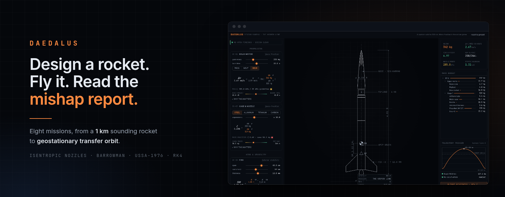
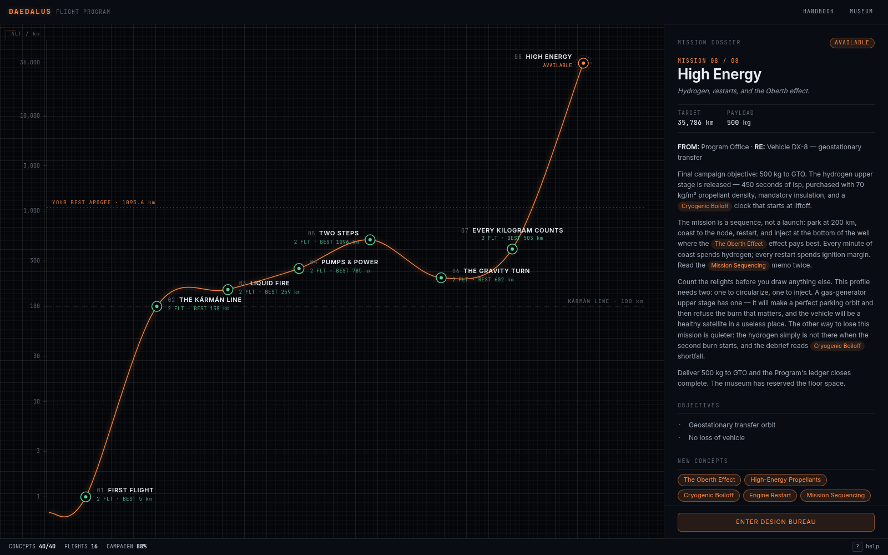
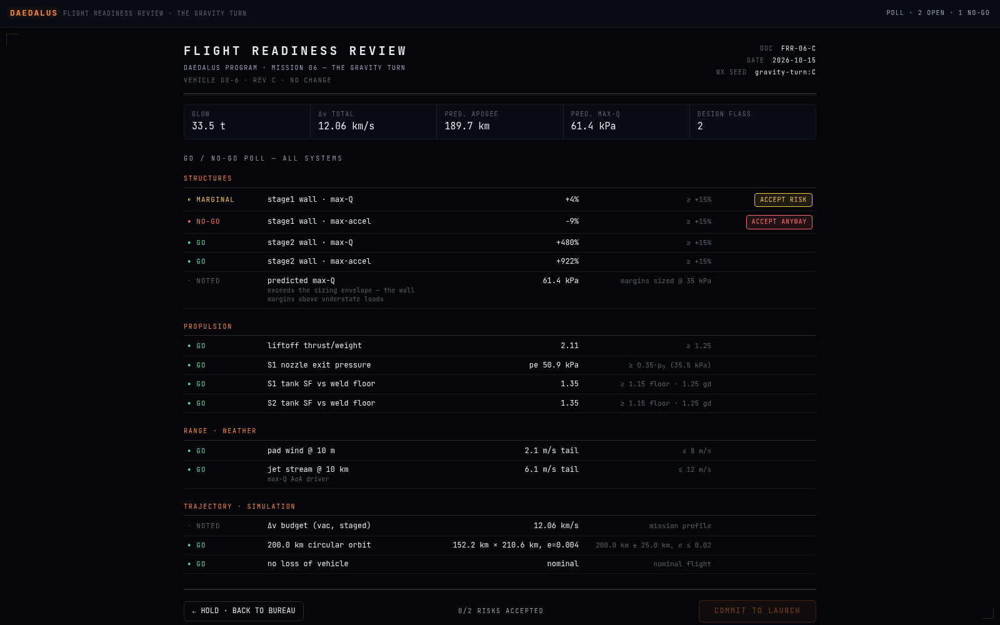
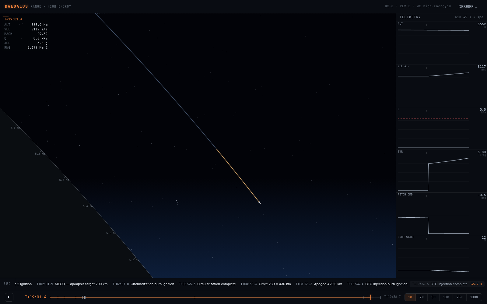
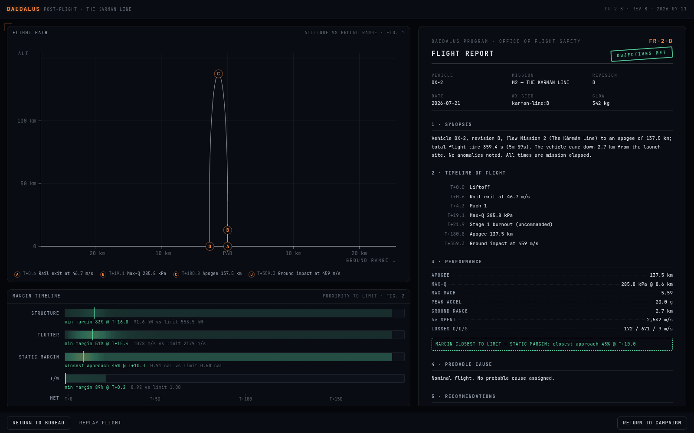

<p align="center"></p>

daedalus is a rocket-design simulator: eight missions, from a 1 km solid
sounding rocket to geostationary transfer orbit, where every flight is a
deterministic physics simulation and every failure is traced to the design
value that caused it. It is for anyone who wants to learn why rockets are
built the way they are by designing one, flying it and reading what went
wrong. The equations are shown with your own numbers in them, so no prior
background is assumed. It runs entirely in the browser:
[zahakj.github.io/daedalus](https://zahakj.github.io/daedalus/).

<p align="center">
  
  
</p>
<p align="center">
  
  
</p>

## Features

- **A campaign of eight missions**: 1 km and a soft landing, the Kármán line,
  a first liquid engine, pump cycles, two stages, a 200 km orbit, a cost-capped
  400 km orbit and GTO. Each starts from a flawed preset and unlocks new parts
  of the design bureau.
- **Decision cards with live equations**: up to 26 cards cover propulsion,
  staging, structures, aerodynamics, recovery, guidance and cost. Each shows its
  governing equation with the current value under every symbol; hovering a
  symbol highlights every readout bound to it.
- **A cutaway drawn to scale**: the vehicle is drawn in real metres from the
  sized tanks, nozzles and motors, with centre of gravity and centre of pressure
  marked, next to a mass tree, Δv against the mission requirement and a
  trajectory preview.
- **A flight readiness review**: the full simulation runs before launch and
  every structural, propulsion, recovery, range and trajectory check is polled
  GO, MARGINAL or NO-GO. Each risk has to be accepted by hand, and since the
  flight is deterministic, a predicted failure is the one that will happen.
- **A range view**: the flight from the pad to orbit, with strip charts, an
  event log and fast playback that drops to real time before each event.
- **A debrief**: a flight report, or a mishap investigation report after a loss,
  with a timeline, one finding per failure filled with the numbers at the moment
  it happened, margin timelines and recommendations that link back to the part
  to change.
- **A handbook and a museum**: 40 concepts, each with a live equation fed by the
  vehicle you are designing, and every completed vehicle drawn at one common
  scale.
- **Share links**: a design, a flight or a report fits in a URL of under
  900 characters and reproduces exactly on another machine.

## Run

Requires Node 20.19+ and pnpm.

```sh
git clone https://github.com/ZahakJ/daedalus && cd daedalus
pnpm install
pnpm dev                    # http://localhost:5701
```

`pnpm build` writes a static site to `dist/`; `pnpm preview` serves it on
port 6701. `pnpm build:pages` builds for GitHub Pages under `/daedalus/`.

## Use

Pick the open mission on the campaign map and enter the design bureau. Each
decision card changes one part of the vehicle and shows the governing
equation with the current numbers in it; the cutaway, mass budget and
trajectory preview update as you drag. The flight readiness review polls
every margin, and each risk must be accepted by hand before launch. Watch
the flight, read the debrief, revise. Press `?` for help on any screen.

Share copies a link that opens your design read-only on anyone's machine;
from the flight or the debrief it opens that flight. Make it mine copies a
shared design into your own campaign.

Progress is saved in the browser's `localStorage`.

## How it works

- `src/physics/` is a pure, deterministic engine in SI units: USSA-1976
  atmosphere, CEA-derived combustion tables, isentropic nozzle flow,
  hoop-stress tank sizing, Barrowman stability, NACA TN 4197 fin flutter and
  thin-shell buckling.
- `simulateFlight(design, { weatherSeed })` integrates a 2D Earth-centred
  inertial trajectory with RK4, flying an open-loop guidance program through
  staging, gravity turn, circularization and restarts, and detects twelve
  failure modes in the loop.
- The launch-day wind is drawn from a generator seeded by the mission, so
  every revision of a vehicle flies the same weather and the difference
  between two flights comes from the design alone.
- The bureau runs closed-form estimates on every edit and the full simulation
  in a Web Worker; the flight and debrief views re-run it from the stored
  design and seed instead of storing trajectories. A share link carries only
  the compressed design for the same reason.
- Tests pin the physics to published values (USSA-1976 tables, Merlin, RL10
  and Raptor Isp, Kepler orbits) and fly a known-good design for every
  mission.

```sh
pnpm typecheck
pnpm test        # vitest: physics anchors, golden designs, every failure mode
pnpm smoke       # build, preview, load every route in headless Chromium
```

## Documentation

- [Architecture](docs/ARCHITECTURE.md): modules, data flow, persistence,
  rendering, tests.
- [Physics](docs/PHYSICS.md): every model and equation in the engine.
- [Campaign](docs/CAMPAIGN.md): missions, objectives, the readiness review
  and the debrief.

## License

[MIT](LICENSE)
